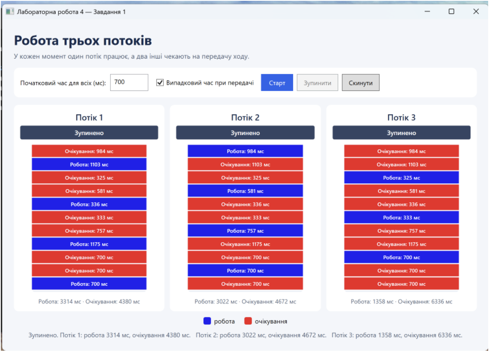

# WPF Three-Thread Simulator

Навчальний WPF-застосунок для наочного показу почергової роботи трьох потоків. Один потік виконує хід, а два інші очікують; після завершення інтервал передається наступному потоку.

**Рекомендована назва GitHub-репозиторію:** `wpf-three-thread-simulator`

## Знімок екрана



## Можливості

- Початковий інтервал від 100 до 5000 мс.
- Циклічна передача ходу: потік 1 → потік 2 → потік 3 → потік 1.
- Режим випадкових інтервалів від 250 до 1200 мс після першого кола.
- Поточний стан кожного потоку та кольорова історія ходів.
- Окремий облік часу роботи й очікування.
- Кнопки запуску, зупинки з підсумком і скидання.

Синій колір позначає роботу, червоний — очікування.

## Технології

- C# і .NET 8
- WPF (Windows Presentation Foundation)
- `Thread`, `BlockingCollection<T>`, `CancellationToken` та засоби синхронізації потоків

## Вимоги та запуск

Потрібні Windows і .NET 8 SDK. WPF є платформою Windows і не запускається як звичайний WPF-застосунок на macOS або Linux.

Відкрийте теку проєкту в терміналі Windows і виконайте:

```powershell
dotnet run
```

Або відкрийте `Lab4_Task1.csproj` у Visual Studio 2022 з компонентом **.NET desktop development**.

## Як користуватися

1. Введіть початковий інтервал у мілісекундах.
2. За бажанням увімкніть випадковий час при передачі.
3. Натисніть **Старт**.
4. Натисніть **Зупинити**, щоб завершити симуляцію та побачити підсумок.
5. Натисніть **Скинути**, щоб очистити історію.

## Структура проєкту

- `App.xaml` і `App.xaml.cs` — запуск WPF-застосунку.
- `MainWindow.xaml` — розмітка вікна та елементи керування.
- `MainWindow.xaml.cs` — логіка інтерфейсу й синхронізація потоків.
- `Lab4_Task1.csproj` — параметри проєкту.
- `docs/screenshots/` — знімок екрана для цього README.

## Створення приватного репозиторію GitHub

Потрібні встановлені [GitHub CLI](https://cli.github.com/) і Git. Спочатку увійдіть у свій GitHub-акаунт:

```bash
gh auth login
```

Потім у терміналі перейдіть до цієї теки й виконайте команди:

```bash
git init -b main
git add .
git commit -m "Initial commit: WPF three-thread simulator"
gh repo create wpf-three-thread-simulator --private --source=. --remote=origin --push
```

Остання команда створить приватний репозиторій `wpf-three-thread-simulator`, додасть `origin` і відправить коміт на GitHub. Якщо таке ім'я вже зайняте у вашому акаунті, замініть його в команді на інше.
